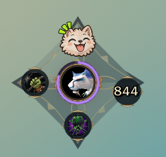
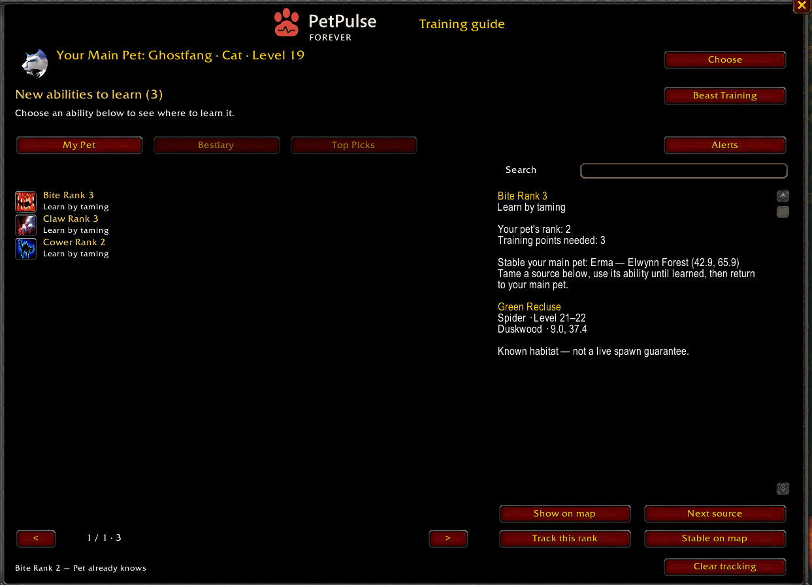
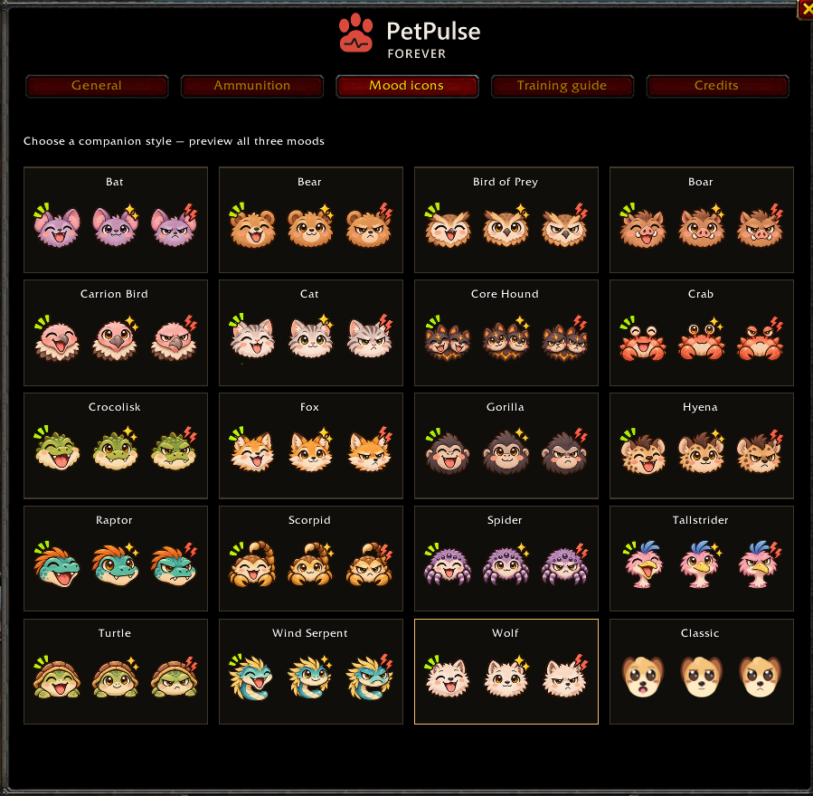

# PetPulse

A companion HUD for Hunters and their pets in **World of Warcraft: Forever**.

PetPulse keeps feeding, happiness, pet XP, training and ammunition close at hand. Hover over your pet portrait to open the controls, or use the minimap paw to open the settings.

## Features

- **Smart Feed:** chooses food your current pet can eat. Safe food takes one click; potentially valuable, buff or quest-related food asks for confirmation. Right-click to choose a specific item with its game tooltip.
- **Pet care:** happiness, feeding duration, pet death and low-health warnings. The portrait changes to Call Pet or Revive Pet when needed.
- **Pet XP:** a progress ring around the portrait and a central level-up announcement.
- **Training Guide:** choose a main pet, see what can be taught now and what unlocks next, and find source beasts, trainers and recorded stable locations.
- **Beast tooltips:** recorded abilities with readable spell icons and their relevance to your main pet. Nearby tips use units actually exposed by the client.
- **Bestiary and Top Picks:** family, level and zone filters, map locations and role-based recommendations.
- **Ammunition:** compatible arrow/bullet counts, adjustable thresholds and central low/critical/empty warnings. Font, color and collapsed visibility are configurable.
- **Companion styles:** 19 pet-family sets with happy, neutral and unhappy artwork, plus the Classic set.
- **EN / SK / CZ**, movable HUD, minimap launcher and per-character preferences.

## Install

Download **PetPulseForever-1.6.6.zip** from [Releases](https://github.com/Therealwixin/PetPulse-Forever/releases/latest), then extract the `PetPulseForever` folder into:

`World of Warcraft/_forever_/Interface/AddOns/`

Restart WoW, enable PetPulse Forever and log in on a Hunter. This build targets **Forever Interface 16001**, not Retail or Classic Era.

## Quick start

- `/petpulse` — settings.
- `/petpulse training` — Training Guide; **Choose** selects your main pet.
- Minimap paw: left-click for settings, right-click for training; drag to reposition.
- `/petpulse minimap` — show/hide the minimap icon.
- `/petpulse unlock` and `/petpulse lock` — move and lock the HUD.
- Right-click Smart Feed — choose food manually.

